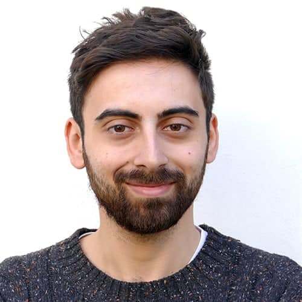

    
    

        <h1>Giordano De Marzo</h1>
        
I'm a postdoctoral researcher and lecturer in the Social Data Science Lab at the University of Konstanz. I study the collective behavior of AI agents: what populations of language-model agents do when they interact, which laws their collective dynamics follow, and how they compare with human groups.

        <!-- Button for downloading the CV -->
    <a href="/files/CV_GiordanoDeMarzo.pdf" class="download-cv-btn" download="Giordano_De_Marzo_CV">Download my CV</a>
    

Bio

My research combines experimental paradigms from the behavioral sciences with the quantitative theory of complex systems to connect the dispositions of individual AI agents to the behavior of their populations. Recent results include a universal law of coordination in societies of AI agents, which can reach consensus via majority-following in groups far larger than human ones (<a href="https://doi.org/10.1126/sciadv.aea6091">Science Advances, 2026</a>), the conditions under which conformity turns individually aligned agents into misaligned collectives, and the first analyses of collective behavior on Moltbook, a social platform populated only by AI agents.

I trained as a theoretical physicist at Sapienza University of Rome (BSc and MSc in Physics), and obtained my PhD in Physics summa cum laude in 2024 at Sapienza and the Enrico Fermi Research Center, with a thesis on modeling complex digital systems supervised by Vittorio Loreto and Luciano Pietronero. My earlier work spans Zipf's law and extreme events, economic complexity, recommender systems and opinion polarization, and the dynamics of novelties. I am a fellow of the Centro Ricerche Enrico Fermi (CREF) in Rome, was a Junior Research Fellow of the Complexity Science Hub Vienna (2023–2026), and have worked as a consultant for the International Labour Organization and the United Nations University.

In Konstanz I teach Network Science of Socio-Economic Systems and Deep Learning for the Social Sciences in the Master's program in Social and Economic Data Science, and I supervise master's theses on the collective behavior of AI agents. All code and data from my research are released openly on <a href="https://github.com/giordano-demarzo">GitHub</a>.

News

    

        
22/01/2025

        
Today I gave a talk at CEU Department of Network and Data Science. More info <a href="https://events.ceu.edu/2025-01-22/emergent-behaviors-llms-populated-societies">here.</a>. You can donwload here the <a href="files/slides/LLMs_CEU.pdf">slides.</a> 

    

    

        
04/12/2024

        
Our team classified second out of 59 at the EPO CodeFest 2024 on generative AI! More details <a href="https://www.epo.org/en/news-events/in-focus/codefest/codefest-2024-generative-ai">here.</a>

    

    

        
25/10/2024

        
Today I gave a talk at Complexity Science Vienna on Large Language Model populated societies. You can donwload here the <a href="files/slides/LLMs_CSH.pdf">slides.</a>

    

    

        
25/10/2024

        
Today I gave a talk at Complexity Science Vienna on Large Language Model populated societies. You can donwload here the <a href="files/slides/LLMs_CSH.pdf">slides.</a> 

    

    

        
21/10/2024

        
Network Science for Socio-Economic Systems is starting today! 

    

    

        
19/10/2024

        
Our work on LLM Societies is in print on the NewScientist! <a href="https://www.newscientist.com/article/2447192-ais-can-work-together-in-much-larger-groups-than-humans-ever-could/">"AIs can work together in much larger groups than humans ever could"</a>. 

    

    
    

        
05/09/2024

        
New preprint out! <a href="https://arxiv.org/abs/2409.02822">"Language Understanding as a Constraint on Consensus Size in LLM Societies"</a>. 

    

    
    

        
08/04/2024

        
Deep Learning for Social Sciences and Computation Modeling of Social Systems starting soon, enroll! 

    

    
    

        
08/04/2024

        
I successfully defended my PhD thesis at Sapienza University! 

    

    
    
    

        
01/02/2024

        
I started as Postdoctoral researcher at <a href="https://www.uni-konstanz.de/en/">Konstanz University</a>.

    

    
    

        
13/09/2023

        
The IMT-CREF PhD and Early Researchers Workshop took place in Lucca. More info <a href="https://cref.it/un-incontro-di-scambio-tra-dottorandi-e-di-cref-e-mit/">here</a>.

    

    

